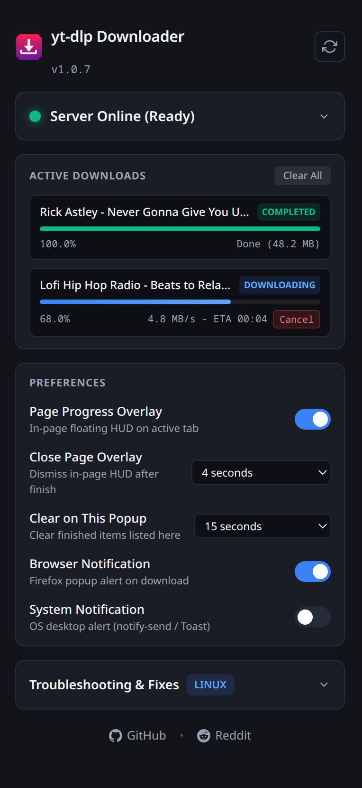

# Download with yt-dlp (Firefox Extension & Local Bridge)

[](LICENSE)
[](https://mozilla.org)
[](https://github.com/PlasmaDrifter/yt-dlp-firefox-extension)
[](https://github.com/yt-dlp/yt-dlp)

A lightweight Firefox / Gecko WebExtension and local bridge server that enables seamless one-click video and audio downloading directly from your browser using **[yt-dlp](https://github.com/yt-dlp/yt-dlp)**.

### Extension Popup

<p align="center">
  
</p>

---

## Features

* **Context Menu Integration**: Right-click on any video, link, or media element and select **"Download video with yt-dlp"**.
* **Real-Time Floating Progress HUD**: Optional in-page glassmorphic HUD card pinned to the bottom right of the tab showing live download percentage, download speed, ETA, and remuxing status.
* **Active Downloads Monitor**: Popup displays all currently running jobs with dynamic progress bars and instant download cancellation.
* **Customizable Preferences**: Toggle the in-page overlay, browser popups, and desktop system notifications directly from the toolbar popup.
* **Zero Browser Overhead**: Downloads run asynchronously in the background via `yt-dlp` without slowing down or locking up your browser.
* **Full yt-dlp Power**: Automatically inherits your custom yt-dlp configuration file (cookies, download folders, audio extraction, video quality formats, metadata, and subtitles).
* **Live Destination Display**: Extension popup automatically queries the bridge server to display your active download folder.
* **Background Autostart**:
  * **Linux**: `systemd --user` service
  * **Windows**: Silent background service (`shell:startup` via `pythonw.exe`)
* **Toolbar Status Popup**: Real-time server health check with one-click refresh, live destination path, notification toggles, and OS-specific troubleshooting tips.
* **Gecko Browser Support**: Compatible with Firefox, Zen Browser, Floorp, LibreWolf, and Waterfox.

---

## Installation & Setup

### Step 1: Set Up the Local Bridge Server

Choose the installer for your operating system:

#### Linux
Run the automated installer to check dependencies and enable the `systemd` user service:
```bash
git clone https://github.com/PlasmaDrifter/yt-dlp-firefox-extension.git
cd yt-dlp-firefox-extension
chmod +x install.sh
./install.sh
```

#### Windows
1. Clone the repository or download the ZIP from GitHub:
```cmd
git clone https://github.com/PlasmaDrifter/yt-dlp-firefox-extension.git
cd yt-dlp-firefox-extension
install.bat
```
2. Simply double-click **`install.bat`**.

> [!IMPORTANT]
> **Python on Windows:**
> - The installer will attempt to install Python 3, `yt-dlp`, and `ffmpeg` automatically using `winget`.
> - If you install Python manually from [python.org](https://www.python.org/downloads/), **make sure to check the box: "Add python.exe to PATH"** at the bottom of the Python installer window. Without this checkbox, Windows redirects Python commands to the Microsoft Store.

To stop and remove the bridge server at any time, double-click **`uninstall.bat`**.

---

### Step 2: Install the Extension in Firefox / Zen / Floorp / LibreWolf

#### Method 1: Install from Firefox Add-ons (Recommended)
Install the official signed version directly from Mozilla Add-ons:
**[Download with yt-dlp on Firefox Add-ons (AMO)](https://addons.mozilla.org/en-US/firefox/addon/download-with-yt-dlp-local/)**

> [!TIP]
> Using the official AMO link is the easiest method for standard Firefox, as it is signed by Mozilla and updates automatically.

---

#### Method 2: Install from Local XPI File
If you prefer installing directly from a local file without using AMO:
1. Open your browser and navigate to `about:addons`.
2. Click the **gear icon** at the top right of the page.
3. Select **"Install Add-on From File..."** and choose `releases/yt-dlp-extension-v1.0.7.xpi`.

> [!IMPORTANT]
> **Signature Requirement:** Standard Firefox releases enforce mandatory add-on signing. If you install an unsigned local `.zip`/`.xpi` file directly on standard Firefox, you will see a signature verification error. To use unsigned files permanently, use **Firefox Developer Edition**, **Firefox Nightly**, **Firefox ESR**, or **LibreWolf** and disable signature checking:
1. Open `about:config`.
2. Set `xpinstall.signatures.required` to `false`.

---

#### Method 3: Load Temporarily in Developer Mode
1. Open your browser and navigate to `about:debugging#/runtime/this-firefox`.
2. Click **"Load Temporary Add-on..."**.
3. Select the `manifest.json` file inside `extension/manifest.json`.
4. The extension will load immediately for your current browser session.

---

## How to Use

1. Navigate to any supported video page (YouTube, Twitch, Twitter/X, Reddit, Vimeo, TikTok, etc.).
2. **Right-click** on the video or video link.
3. Click **"Download video with yt-dlp"** in the context menu.
4. An optional in-page floating HUD card displays live download progress (percentage, speed, and ETA) right on your active tab.
5. You can also click the toolbar icon at any time to monitor active downloads or cancel in-flight jobs.
6. The downloaded video will be saved directly into your configured `yt-dlp` folder (or `~/Downloads`).

---

## Customization & Configuration

The extension triggers your system's `yt-dlp` binary, which automatically reads all settings from **`~/.config/yt-dlp/config`**.

### Example `~/.config/yt-dlp/config`:
```text
# Default download directory
-P ~/Downloads/

# Best quality video and audio merged into MP4
-f "bv*+ba/b"
--merge-output-format mp4

# Embed metadata and subtitles
--embed-metadata

# (Optional) Cookies file for private or age-restricted videos
--cookies ~/.config/yt-dlp/cookies.txt
```

---

## Troubleshooting

### 1. Check if the local bridge server is running
* **Linux**:
  ```bash
  systemctl --user status yt-dlp-server.service
  ```
  If stopped, restart the background service:
  ```bash
  systemctl --user restart yt-dlp-server.service
  ```
* **Windows**:
  * Launch the background server directly via PowerShell or Command Prompt:
    ```cmd
    pythonw.exe "%LOCALAPPDATA%\yt-dlp-bridge\server.py"
    ```
  * Or re-run the Windows installer to restore the startup shortcut and server:
    ```cmd
    install.bat
    ```
  * To check running bridge processes in PowerShell:
    ```powershell
    Get-Process pythonw, python | Where-Object { $_.CommandLine -like "*yt-dlp-bridge*" }
    ```

### 2. Test the health check endpoint
* **Linux / macOS**:
  ```bash
  curl http://127.0.0.1:16800/health
  ```
* **Windows (PowerShell)**:
  ```powershell
  Invoke-RestMethod http://127.0.0.1:16800/health
  ```
  *(Expected output: `{"status":"ok","service":"yt-dlp-bridge",...}`)*

### 3. Check service logs and errors
* **Linux**:
  Inspect live systemd journal logs:
  ```bash
  journalctl --user -u yt-dlp-server.service -f
  ```
* **Windows**:
  Inspect the log file created by the bridge server:
  ```powershell
  Get-Content "$env:LOCALAPPDATA\yt-dlp-bridge\server.log" -Wait -Tail 20
  ```
  Or in Command Prompt:
  ```cmd
  type "%LOCALAPPDATA%\yt-dlp-bridge\server.log"
  ```

### 4. Verify yt-dlp and ffmpeg dependencies
* **Windows**:
  Ensure both tools are accessible in your PATH:
  ```cmd
  yt-dlp --version
  ffmpeg -version
  ```
  If missing, install them via winget:
  ```cmd
  winget install yt-dlp.yt-dlp Gyan.FFmpeg Python.Python.3.12
  ```
* **Linux**:
  ```bash
  yt-dlp --version
  ffmpeg -version
  ```
---

## License
This project is licensed under the [MIT License](LICENSE).

---

## Community & Discussions

Got questions, setup ideas, or feedback?

* Join our subreddit at [**r/PlasmaDrifterProjects**](https://reddit.com/r/PlasmaDrifterProjects) to discuss updates, get support, and share configurations.
* Contact directly via email at [**plasmadrifter121@gmail.com**](mailto:plasmadrifter121@gmail.com).
